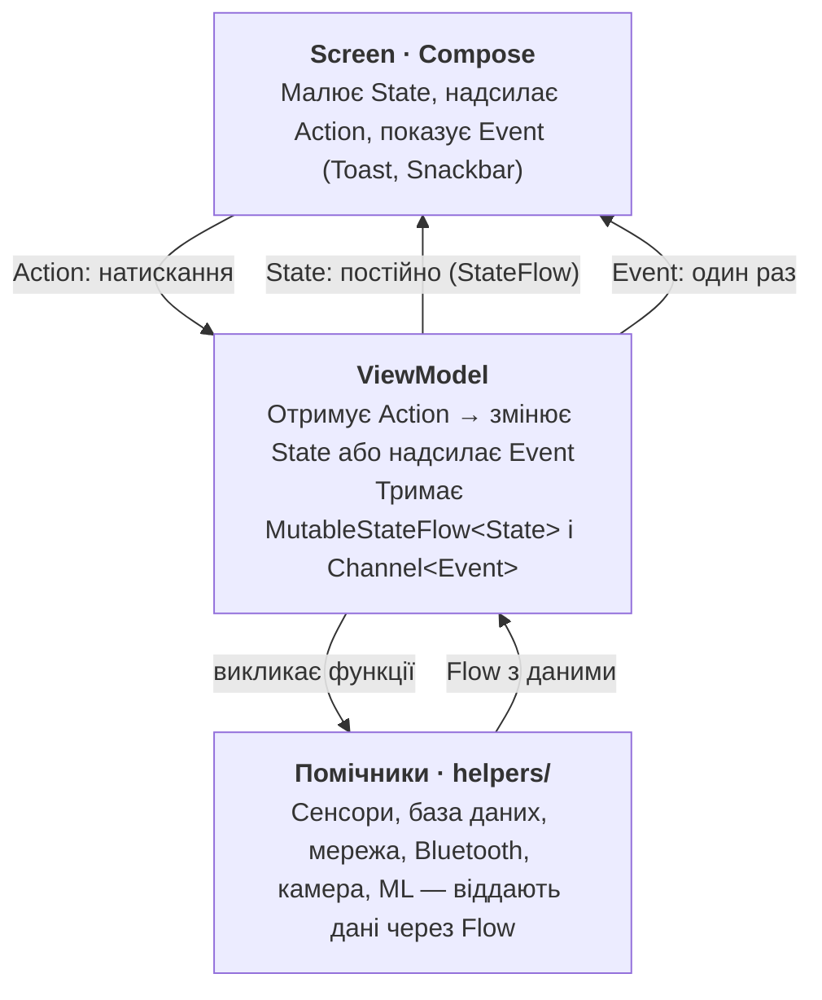

# Архітектура навчального смарт-додатку (ЛР 1–7)

_Oct 6, 2026 · @Dmytro Herez_

## Архітектура додатку: MVI

### Ідея в одному реченні

Кожен екран будуємо за схемою **MVI**: екран надсилає **Action**, ViewModel змінює **State**, екран перемальовується. Більше нічого не потрібно — ні шарів, ні складних фреймворків.

Увесь додаток тримається на п'яти поняттях:

| Поняття | Що це простими словами | У коді |
|---|---|---|
| **State** | Усе, що зараз видно на екрані | `data class XxxState(...)` |
| **Action** | Що зробив користувач (натиснув, увімкнув, ввів) | `sealed interface XxxAction` |
| **Event** | Разова дія: Toast, Snackbar, перехід на інший екран | `sealed interface XxxEvent` |
| **ViewModel** | "Мозок" екрана: отримує Action, змінює State, шле Event | `class XxxViewModel : ViewModel()` |
| **Flow** | "Труба", по якій дані течуть з часом (сенсор, база, мережа) | `StateFlow`, `Flow`, `Channel` |

Чим State відрізняється від Event: State — це **те, що є** (значення сенсора, статус з'єднання), він живе, поки живе екран. Event — це **те, що сталося один раз** (показати повідомлення). Якщо покласти Toast у State, він з'являтиметься знову після повороту екрана.

## Як дані йдуть по колу

Дані йдуть по колу: **Action → ViewModel → State**



_цикл MVI · Screen, ViewModel, помічники_

Дані рухаються лише в одному напрямку: користувач тисне кнопку → Action → ViewModel → новий State → екран перемальовується сам. Дані від сенсора чи мережі теж заходять у ViewModel і перетворюються на State. Екран ніколи не звертається до помічників напряму.

## Шаблон екрана

Кожен екран — це **три файли**: Contract (State + Action + Event), ViewModel і Screen, плюс MainActivity, яка показує екран. Нижче — повний робочий приклад екрана, що показує дані акселерометра. Копіюйте його як заготовку для будь-якого нового екрана.

### Файл 1 — `MonitorContract.kt`: що є на екрані і що з ним можна робити

```kotlin
// State — все, що показуємо. Тільки val, значення за замовчуванням обов'язкові.
data class MonitorState(
    val x: Float = 0f,
    val y: Float = 0f,
    val z: Float = 0f,
    val isRunning: Boolean = false
)

// Action — усі дії користувача на цьому екрані.
sealed interface MonitorAction {
    data object Start : MonitorAction
    data object Stop : MonitorAction
    data object ResetClick : MonitorAction
}

// Event — разові повідомлення від ViewModel до екрана.
sealed interface MonitorEvent {
    data class ShowMessage(val text: String) : MonitorEvent
}
```

### Файл 2 — `MonitorViewModel.kt`: вся логіка екрана

```kotlin
class MonitorViewModel(app: Application) : AndroidViewModel(app) {

    // Помічник, що працює з Android API (див. нижче)
    private val sensorReader = SensorReader(app)

    // State: приватний змінюваний + публічний тільки для читання
    private val _state = MutableStateFlow(MonitorState())
    val state: StateFlow<MonitorState> = _state.asStateFlow()

    // Event: Channel доставляє кожну подію рівно один раз
    private val _events = Channel<MonitorEvent>()
    val events = _events.receiveAsFlow()

    private var sensorJob: Job? = null

    // ЄДИНИЙ вхід у ViewModel — всі дії приходять сюди
    fun onAction(action: MonitorAction) {
        when (action) {
            MonitorAction.Start -> startSensor()
            MonitorAction.Stop -> stopSensor()
            MonitorAction.ResetClick -> {
                _state.update { it.copy(x = 0f, y = 0f, z = 0f) }
                viewModelScope.launch { _events.send(MonitorEvent.ShowMessage("Скинуто")) }
            }
        }
    }

    private fun startSensor() {
        if (sensorJob != null) return
        _state.update { it.copy(isRunning = true) }
        sensorJob = viewModelScope.launch {
            sensorReader.readings().collect { v ->
                _state.update { it.copy(x = v[0], y = v[1], z = v[2]) }
            }
        }
    }

    private fun stopSensor() {
        sensorJob?.cancel()   // скасування Flow → unregisterListener()
        sensorJob = null
        _state.update { it.copy(isRunning = false) }
    }
}
```

### Файл 3 — `MonitorScreen.kt`: тільки малює State і надсилає Action

```kotlin
@Composable
fun MonitorScreen(vm: MonitorViewModel) {
    val state by vm.state.collectAsStateWithLifecycle()
    val context = LocalContext.current

    // Слухаємо разові Event
    LaunchedEffect(Unit) {
        vm.events.collect { event ->
            when (event) {
                is MonitorEvent.ShowMessage ->
                    Toast.makeText(context, event.text, Toast.LENGTH_SHORT).show()
            }
        }
    }

    MonitorContent(state = state, onAction = vm::onAction)
}

// Чиста функція: State на вході, Action на виході. Легко робити Preview.
@Composable
fun MonitorContent(state: MonitorState, onAction: (MonitorAction) -> Unit) {
    Column(Modifier.padding(16.dp)) {
        Text("X: %.2f  Y: %.2f  Z: %.2f".format(state.x, state.y, state.z))
        LinearProgressIndicator(progress = { ((state.x + 10f) / 20f).coerceIn(0f, 1f) })
        Button(onClick = { onAction(MonitorAction.ResetClick) }) { Text("Скинути") }
    }
}
```

### Файл 4 — `MainActivity.kt`: показує екран і керує життєвим циклом

Додаток має один екран, тому `onResume()` і `onPause()` пишемо прямо в `MainActivity`. Activity лише перетворює ці події на Action — логіки тут немає.

```kotlin
class MainActivity : ComponentActivity() {

    // Та сама ViewModel переживає поворот екрана
    private val vm: MonitorViewModel by viewModels()

    override fun onCreate(savedInstanceState: Bundle?) {
        super.onCreate(savedInstanceState)
        setContent { MonitorScreen(vm) }
    }

    override fun onResume() {
        super.onResume()
        vm.onAction(MonitorAction.Start)   // екран видно → слухаємо сенсор
    }

    override fun onPause() {
        vm.onAction(MonitorAction.Stop)    // екран сховано → відписуємось, економимо батарею
        super.onPause()
    }
}
```

При повороті екрана Activity створюється заново: `onPause` → `Stop`, потім `onResume` → `Start`. ViewModel і її State при цьому не губляться.

### Помічник — `SensorReader.kt`: перетворює Android API на Flow

Код, що працює з системою (сенсори, Bluetooth, база, мережа, камера), виносимо в окремий клас-помічник. Він повертає `Flow` або має `suspend`-функції, а ViewModel просто його викликає.

```kotlin
class SensorReader(context: Context) {
    private val manager = context.getSystemService(SensorManager::class.java)
    private val sensor = manager.getDefaultSensor(Sensor.TYPE_ACCELEROMETER)

    fun readings(): Flow<FloatArray> = callbackFlow {
        val listener = object : SensorEventListener {
            override fun onSensorChanged(e: SensorEvent) { trySend(e.values.clone()) }
            override fun onAccuracyChanged(s: Sensor?, a: Int) = Unit
        }
        manager.registerListener(listener, sensor, SensorManager.SENSOR_DELAY_UI)
        awaitClose { manager.unregisterListener(listener) }  // викликається при cancel()
    }
}
```

## Структура файлів

Одна папка на екран, одна спільна папка для помічників. Нові функції додаються новими папками, а старі файли не переписуються.

```
com.example.smartapp
├── MainActivity.kt             // setContent + onResume/onPause → Action
│
├── monitor/                    // один екран = одна папка
│   ├── MonitorContract.kt      // State + Action + Event
│   ├── MonitorViewModel.kt
│   └── MonitorScreen.kt
│
├── settings/                   // наступний екран — за тим самим шаблоном
│   ├── SettingsContract.kt
│   ├── SettingsViewModel.kt
│   └── SettingsScreen.kt
│
├── repository/                 // збереження і відправка даних
│   ├── SensorRepository.kt
│   ├── SensorReading.kt        // модель для ViewModel
│   ├── CloudApi.kt             // + SensorPayload (JSON)
│   └── AppDatabase.kt          // + SensorDao, SensorRecord (Room)
│
└── helpers/                    // класи, що працюють з Android API
    ├── SensorReader.kt
    └── ...                     // Bluetooth, камера, вібрація, ML тощо
```

Назви файлів завжди однакові: `XxxContract`, `XxxViewModel`, `XxxScreen`. Відкривши будь-яку папку, одразу зрозуміло, де що лежить.

## Репозиторій: одне місце для даних

Коли дані треба **зберігати** (база даних Room) або **відправляти** (хмара), ViewModel не працює з ними напряму. Вона звертається до **репозиторію** — класу, який сам вирішує, куди і як покласти дані. Головна вигода: коли згодом додається нове сховище, ViewModel і екран не змінюються.

```
ViewModel ──► SensorRepository ──┬─► CloudApi   (Retrofit або Firebase)
                                 └─► SensorDao  (Room, додається пізніше)
```

**Крок 1 — тільки хмара.** Репозиторій має одну `suspend`-функцію і повертає `Result`, щоб ViewModel знала, чи вдалося.

```kotlin
class SensorRepository(private val api: CloudApi) {

    suspend fun save(reading: SensorReading): Result<Unit> =
        withContext(Dispatchers.IO) {                 // мережа — не в головному потоці
            runCatching { api.upload(reading.toPayload()) }
        }
}
```

**Крок 2 — додаємо Room.** Змінюється лише репозиторій: спершу пишемо в базу, потім відправляємо в хмару. Якщо мережі немає, запис лишається в базі з `synced = false` і відправиться пізніше.

```kotlin
class SensorRepository(
    private val api: CloudApi,
    private val dao: SensorDao
) {
    // Історія для графіка: Room сам оновлює Flow при кожному новому записі
    fun history(): Flow<List<SensorRecord>> = dao.latest(50)

    suspend fun save(reading: SensorReading): Result<Unit> =
        withContext(Dispatchers.IO) {
            val id = dao.insert(reading.toRecord())      // 1. спершу локально
            runCatching { api.upload(reading.toPayload()) }  // 2. потім у хмару
                .onSuccess { dao.markSynced(id) }
        }

    // Відправити все, що не пішло, коли мережа повернулася
    suspend fun syncPending() = withContext(Dispatchers.IO) {
        dao.unsynced().forEach { record ->
            runCatching { api.upload(record.toPayload()) }
                .onSuccess { dao.markSynced(record.id) }
        }
    }
}
```

**ViewModel однакова для обох кроків** — вона лише викликає `save()` і перетворює результат на State та Event:

```kotlin
private fun upload(reading: SensorReading) = viewModelScope.launch {
    repository.save(reading)
        .onSuccess { _state.update { it.copy(syncStatus = SyncStatus.Synced) } }
        .onFailure {
            _state.update { it.copy(syncStatus = SyncStatus.Pending) }
            _events.send(MonitorEvent.ShowMessage("Немає мережі"))
        }
}
```

Три моделі даних — і це нормально:

| Модель | Для чого | Де лежить |
|---|---|---|
| `SensorReading` | Те, з чим працює ViewModel і State | `repository/` |
| `SensorPayload` | Як дані виглядають у JSON для хмари | `repository/` |
| `SensorRecord` (`@Entity`) | Рядок таблиці Room | `repository/` |

Перетворення між ними — короткі функції `toPayload()` і `toRecord()` поруч із моделями. Так зміна формату JSON не ламає базу, і навпаки.

Репозиторій створюйте **один на весь додаток**, наприклад в `object` або класі `Application`. Інакше кожен екран матиме свою копію, і дані роз'їдуться.

## Як додати нову функцію

Будь-яке нове завдання (нова кнопка, новий датчик, збереження, відправка в мережу) робиться тими самими кроками:

1. **State.** Що нового має з'явитися на екрані? Додайте поле в `XxxState` зі значенням за замовчуванням.
2. **Action.** Що нового може зробити користувач? Додайте варіант у `XxxAction`.
3. **Event.** Чи треба показати разове повідомлення або перейти на інший екран? Додайте варіант у `XxxEvent`.
4. **Репозиторій або помічник.** Дані треба зберегти в базу чи відправити в хмару? Додайте метод у репозиторій. Потрібен доступ до сенсора, камери чи іншого Android API? Створіть клас у `helpers/`, що повертає `Flow` або має `suspend`-функції.
5. **ViewModel.** Обробіть новий Action у `when` всередині `onAction()`. Оновіть State через `_state.update { it.copy(...) }`.
6. **Screen.** Покажіть нове поле State і викликайте `onAction(...)` з кнопок.

Якщо функція велика і не вміщається на поточний екран — створіть новий екран за шаблоном вище.

## Правила і типові помилки

| Правило | Неправильно | Правильно |
|---|---|---|
| Екран не містить логіки | `if (x > 10) vibrate()` у Composable | Перевірка у ViewModel, екран лише показує State |
| State змінює тільки ViewModel | Публічний `MutableStateFlow` | Приватний `_state`, назовні `StateFlow` |
| State незмінний | `var` у State, `state.x = 5f` | `val` у State, `_state.update { it.copy(x = 5f) }` |
| Один вхід у ViewModel | Багато функцій `onStartClick()`, `onStopClick()` … | Одна `onAction(action)` з `when` |
| Разові дії — через Event | `val toastText: String?` у State | `Channel<XxxEvent>` + `LaunchedEffect` |
| Android API — у помічниках | `SensorManager`, Room, Retrofit прямо у ViewModel | Клас у `helpers/`, ViewModel його викликає |
| Довгі операції — не в головному потоці | Запит до бази чи мережі напряму в `onAction` | `viewModelScope.launch { ... }` (база й мережа — з `Dispatchers.IO`) |
| Ресурси звільняються | Сенсор слухає, навіть коли додаток згорнуто | Зупинка в `onPause` (`override onPause()` у `MainActivity` → Action `Stop`) |
| Дані — через репозиторій | ViewModel сама викликає Retrofit, Firebase чи DAO | ViewModel викликає `repository.save()`, репозиторій вирішує, куди писати |